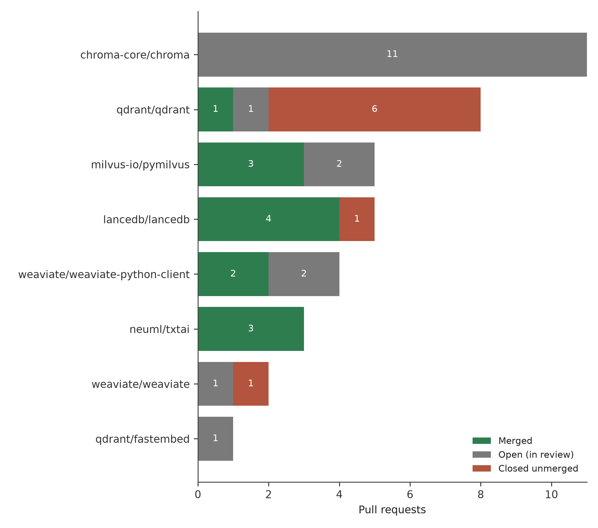
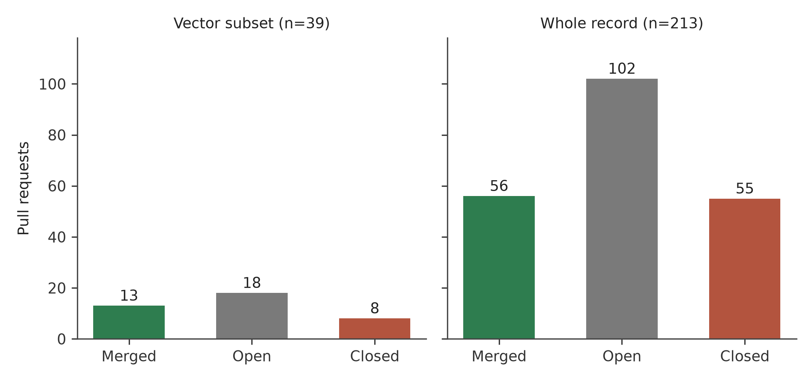
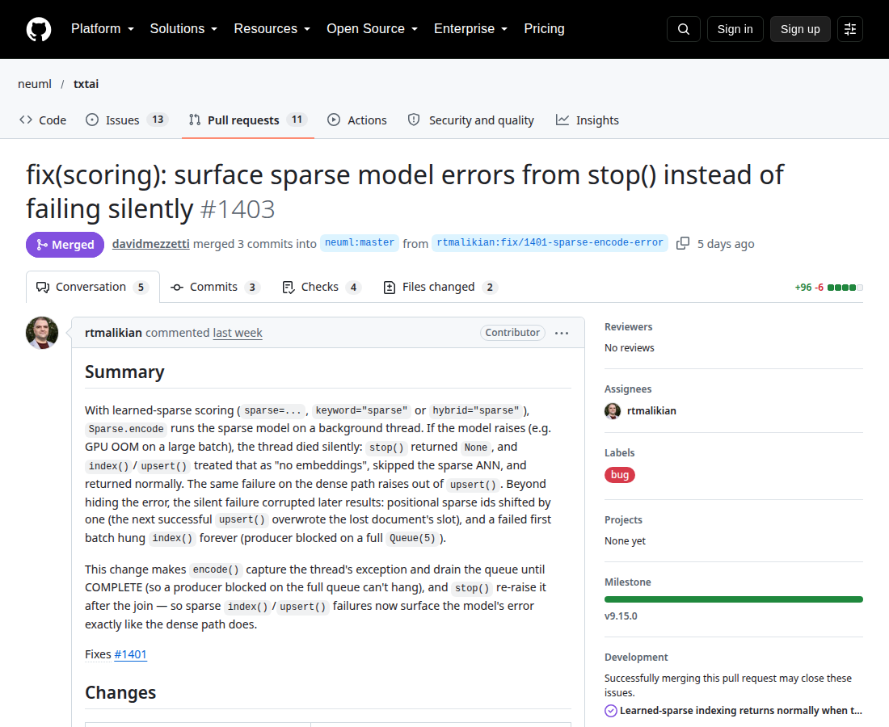

# 📄 Download the full article — PDF

[](https://github.com/rtmalikian/vector-databases-rag-clinical-ai-infrastructure/raw/main/article3-vector-databases.pdf)

### 👉 [**Click here to download the PDF**](https://github.com/rtmalikian/vector-databases-rag-clinical-ai-infrastructure/raw/main/article3-vector-databases.pdf)

*One click — no sign-up, no paywall. The full text is also embedded in this README below.*

---

# Retrieval Is the New Record System: A Retrospective Analysis of Open-Source Contributions to Vector Databases and Embedding Infrastructure Underpinning Clinical AI (2025-2026)

**Author:** Raphael T. Malikian, MBBS BSc (Hons), Independent Researcher, Palmdale, California, USA
**Profile:** https://github.com/rtmalikian

[](https://doi.org/10.5281/zenodo.23549144)
**Preprint:** [Zenodo](https://doi.org/10.5281/zenodo.23549144) | **License:** CC BY 4.0 | **PDF:** [article3-vector-databases.pdf](article3-vector-databases.pdf)

Submitted to the Journal of Biomedical Informatics (Manuscript JBI-26-4036). Preprint: Zenodo.

## About this paper

This paper studies vector databases and embedding tools that support retrieval-augmented generation in clinical artificial intelligence. It covers 39 pull requests in 8 repositories, with 13 merged, 8 closed unmerged and 18 still open at extraction on 21 October 2026. Cases from Chroma, Milvus, Qdrant, LanceDB, Weaviate and txtai show how silent failure and slow review affect retrieval systems that clinical tools depend on.

## Full article

## Abstract

**Background.** Retrieval-augmented generation (RAG) sits inside many clinical artificial intelligence (AI) prototypes. A language model answers from documents a retrieval layer selects first. If that layer returns the wrong documents, or returns nothing and reports success, the error starts before the model generates a word. Vector databases and embedding tools form that retrieval layer in most designs, so their defects count as health infrastructure defects.

**Purpose.** This study analysed one contributor's public pull request (PR) record in vector database and retrieval projects. It asked three practical questions in sequence. What kinds of defects did the contributions address? What share of the work reached merge? Where did the process break down?

**Methods.** On 21 October 2026 I extracted my full PR record through the GitHub API (author:rtmalikian): 213 PRs across 94 repositories (85 external projects and 9 of the author's own repositories). I defined a subset for vector databases and retrieval infrastructure: 39 PRs across 8 repositories. I coded each PR by status at extraction and read the review threads of seven cases in depth. Two cases from projects next to the subset, cocoindex-io/cocoindex and sentence-transformers, were read for comparison and kept out of the subset counts.

**Results.** Of the 39 subset PRs, 13 merged, 18 were still open, and 8 closed unmerged. Among the 21 resolved PRs, 61.9% merged. Open PRs made up 46% of the subset, the highest share in any part of my record. The merged work clustered around one defect class: silent failure. Code accepted values it should have rejected, dropped errors in background threads, or hid missing data behind a normal response. The hardest case was a long-lived branch. pymilvus #3621 sat open from 20 June 2026 with 12 comments, merge conflicts, and a Developer Certificate of Origin (DCO) gap on a sync commit.

**Conclusions.** The code in this subset was rarely the slow part. Review time was. The fixes that landed shared one pattern: they made a system fail loudly, with an accurate message, at the point where bad data entered. A retrieval system that says "no record found" when it means "the index is corrupt" will mislead a clinician the way a silent defect misleads a developer.

## Introduction

A clinician who asks a question of a modern AI assistant rarely queries a model alone. The usual design retrieves first. The system embeds the question into a vector, searches an index for near neighbours, and passes the closest passages to the model as context [10,11]. Lewis and colleagues formalised this design as retrieval-augmented generation in 2020 [10]. Gao and colleagues surveyed the method's growth three years later [11]. Karpukhin and colleagues showed that a learned dense retriever could beat a strong term-based baseline [12]. Reimers and Gurevych built Sentence-BERT on BERT [15] to embed sentences in practice [13]. Khattab and Zaharia added late interaction with ColBERT [14]. Each step moved attention away from the model and towards the plumbing.

The plumbing has a history of its own. Product quantisation came from Jégou, Douze and Schmid in 2011 [4]. Muja and Lowe set out scalable methods for high-dimensional data [5]. Guo and colleagues reported ScaNN in 2020 [9]. Malkov and Yashunin published the hierarchical navigable small world graph method that many current indexes still use [1]. Billion-scale search on graphics processors came from Johnson, Douze and Jégou [2], and the Faiss library paper followed from Douze and colleagues [3]. Guo and colleagues reported ScaNN in 2020 [9]. Aumüller and colleagues built ANN-Benchmarks for shared comparison [6]. Wang and colleagues presented Milvus at SIGMOD in 2021 [7]. Pan, Wang and Li surveyed vector database management systems in 2024 and treated them as a distinct class of database [8].

Medicine has started to build on this stack. Xiong and colleagues benchmarked RAG for medicine in 2024 and found retrieval quality varied widely across tasks [16]. Zakka and colleagues described Almanac in NEJM AI in the same year, a clinical copilot that grounds answers in retrieved sources [17]. Singhal and colleagues showed that large language models encode a large amount of clinical knowledge [18]. Nori and colleagues reported GPT-4 results on medical challenge problems [19]. Jin and colleagues built PubMedQA so biomedical question answering could be measured [20]. Topol argued in 2019 that high-performance medicine would depend on data systems as much as on algorithms [21], a point Rajpurkar, Chen, Banerjee and Topol repeated in 2022 [22]. The model gets the citation. The index does much of the work.

That picture carries a risk the clinical literature states in a different language. Kahn and colleagues published a harmonised framework for assessing the quality of electronic health record data used for secondary purposes [23]. Their categories fit retrieval indexes well. A record can be present and wrong. A value can conform to a stated type and still be false. Vector systems add a failure mode of their own: the query succeeds, the response is well formed, and the answer is an empty set that the calling code reads as a true negative. In a billing system that is a bug. In a system that supplies context for a clinical answer, it is a safety problem wearing a bug's clothes.

This paper examines that problem from an unusual seat: the contributor's. Between June and October 2026 I submitted pull requests to projects that build vector databases, their client libraries, and the embedding tools around them. Some merged within days. Some are still waiting. One accumulated conflicts for four months. The record is public, timestamped, and argued over in writing by named maintainers. A survey cannot give that account. This record can.

My background belongs in the open here. I trained in medicine in London and completed family medicine residency training in the United States. I then bootstrapped and ran a direct primary care clinic as chief executive. I now build clinical AI. I read a sparse vector validation error the way I once read a laboratory interface error. Both sit at a boundary where one system trusts what another sends it.

### Purpose of the Paper

The literature named above describes retrieval systems from the user's side. It measures answer quality and benchmark scores. It says little about how the underlying code gets fixed, or what happens to a correct fix after a contributor submits it. Maintainers publish no review queue data as a health metric for their own infrastructure. Neither source gives a dated, counted account of defect work inside the retrieval layer.

This paper fills that gap with one contributor's complete public record in these projects, coded from the GitHub API and read thread by thread. It names the defect classes that one clinical reader kept finding at data boundaries. It puts numbers on review delay inside fast-growing AI infrastructure projects. It records, with dates and comment counts, how disagreements about root cause were settled in public.

Three research questions organise the work. RQ1: What defect classes did the merged contributions in this subset address, and what pattern links them? RQ2: What share of the subset reached merge, and where did the rest stall? RQ3: How were disagreements and rejections in the review threads handled, and what did those exchanges produce?

## Methods

### Data source and extraction

Data came from the GitHub REST API. On 21 October 2026 I ran an author search for pull requests authored by rtmalikian. It returned 213 PRs across 94 repositories (85 external projects and 9 of the author's own repositories): 56 merged, 55 closed unmerged, and 102 open. Fifty-four of the merged PRs were in repositories owned by other people or organisations. Two were in my own repositories and carry less weight as external review. Every PR has a public page with its discussion, review history, commits, and check results.

### Subset definition

The subset includes repositories whose main job is vector storage, vector search, or embedding and retrieval support. Eight met that test: chroma-core/chroma, milvus-io/pymilvus, qdrant/qdrant, lancedb/lancedb, weaviate/weaviate-python-client, neuml/txtai, qdrant/fastembed, and weaviate/weaviate. The subset holds 39 PRs, each counted once, under the repository it was opened against. Client libraries count with their parent system, because a client defect changes what an application can send to the server.

Two cases sit outside the subset and count as comparison material only. cocoindex-io/cocoindex is a data indexing framework. It feeds retrieval systems and stores no vectors itself. sentence-transformers produces embeddings, and one PR there raised a question about which layer should own a fix. Neither case changes the subset denominator of 39.

### Coding and case selection

I coded status from the API fields at extraction: merged, open, or closed unmerged. Percentages use resolved PRs (merged plus closed unmerged, n=21) for outcome claims, and all 39 PRs for claims about work in flight. Seven cases were selected for close reading. Selection favoured cases with a written review thread long enough to show reasoning. Short cases with no discussion add counts. They teach little.

### Ethics

This study used public data only. Every PR, comment, and review cited here was published by its author on a public repository. No patient data and no private correspondence appear in this paper. No institutional review board approval was required.

## Results

### The subset in numbers

Table 1 gives the subset by repository. Figure 1 plots the same counts. The spread is uneven, and the unevenness is part of the result. txtai merged all three of its PRs. LanceDB merged four of five. Chroma merged none of eleven, because none had reached a decision at extraction. Qdrant closed six of eight unmerged. A single average merge rate hides each row's story about review load and triage habits.

**Table 1. Pull requests by the author in vector database and retrieval repositories, extracted 21 October 2026.**

| Repository | Total | Merged | Open | Closed unmerged |
|---|---|---|---|---|
| chroma-core/chroma | 11 | 0 | 11 | 0 |
| milvus-io/pymilvus | 5 | 3 | 2 | 0 |
| qdrant/qdrant | 8 | 1 | 1 | 6 |
| lancedb/lancedb | 5 | 4 | 0 | 1 |
| weaviate/weaviate-python-client | 4 | 2 | 2 | 0 |
| neuml/txtai | 3 | 3 | 0 | 0 |
| qdrant/fastembed | 1 | 0 | 1 | 0 |
| weaviate/weaviate | 2 | 0 | 1 | 1 |
| **Total** | **39** | **13** | **18** | **8** |

**Figure 1. Pull requests by repository, split by outcome, 21 October 2026.** Horizontal stacked bars, one per repository, segments in the order merged, open, closed unmerged. Counts are from Table 1.



<!-- Figure 1 data series, for plotting verbatim.
Repositories in order: chroma-core/chroma; milvus-io/pymilvus; qdrant/qdrant; lancedb/lancedb; weaviate/weaviate-python-client; neuml/txtai; qdrant/fastembed; weaviate/weaviate.
Merged:         0, 3, 1, 4, 2, 3, 0, 0
Open:           11, 2, 1, 0, 2, 0, 1, 1
Closed unmerged: 0, 0, 6, 1, 0, 0, 0, 1
Totals:         11, 5, 8, 5, 4, 3, 1, 2 (sum 39)
-->

The headline figure deserves care. Thirteen of 39 PRs merged, which reads as 33%. That figure mixes finished decisions with work still in flight. Among the 21 PRs that had reached a decision, 13 merged and 8 closed unmerged, a merge share of 61.9%. The remaining 18 PRs, 46% of the subset, were still open at extraction. Figure 2 sets that outcome summary beside the whole record. No other part of my wider record had so much work sitting in review at once. Code waits.

Speed varied where decisions did happen. txtai #1403 went from opening to merge in three days, with two full rounds of review in that window. qdrant/qdrant #9638 took about 13 days to its merge on 13 July 2026. pymilvus #3621 opened on 20 June 2026 and was still open four months later. Same contributor. Same working habits. Very different clocks.
**Figure 2. Outcome summary: subset beside whole record, 21 October 2026.** Subset (n=39): merged 13, open 18, closed unmerged 8. Whole record (n=213): merged 56, open 102, closed unmerged 55. Eight repositories carry all 18 open subset PRs.



<!-- Figure 2 data, for plotting verbatim.
Subset: merged 13; open 18; closed unmerged 8 (n=39).
Whole record: merged 56; open 102; closed unmerged 55 (n=213).
-->


### Cases

Table 2 lists the seven cases read in depth, plus the fastembed case on conflict decay. The text below follows the order of the table.

**Table 2. Cases read in depth.**

| Case | Project | Outcome at extraction | Point it makes |
|---|---|---|---|
| #3624, #3638, #3642 | milvus-io/pymilvus | Merged June to July 2026 | Type errors at a boundary can corrupt an index quietly |
| #9638 (after #9627) | qdrant/qdrant | Merged 13 July 2026 | A second, reworked attempt can land where a first failed |
| #1403 | neuml/txtai | Merged 16 October 2026 | A demand for full test coverage can teach, if the contributor lets it |
| #13471, then #13570 | weaviate/weaviate | Closed unmerged 13 October 2026; new PR open | A project may ship its own fix. That is a normal outcome |
| #2536 | cocoindex-io/cocoindex | Open, comparison case | Root-cause disputes settle by rework, with evidence |
| #3621 | milvus-io/pymilvus | Open since 20 June 2026, 12 comments | Long branches decay. Unsigned commits cost maintainer time |
| #4122 | sentence-transformers | Closed unmerged 7 October 2026, comparison case | A fix can belong in a different layer than the one that shows the symptom |
| #744 | qdrant/fastembed | Open, in conflict | Upstream code moves while a PR waits. The target shifts |

#### Sparse vectors and a Python trap: pymilvus #3624, #3638 and #3642

Three PRs in the Python client for Milvus dealt with sparse vector validation. All three merged between June and July 2026. The underlying trap is a language fact. In Python, the boolean values True and False belong to the integer type. Code that checks whether a value is an integer will accept True as 1 and False as 0 unless it refuses booleans on purpose. Sparse vectors are lists of indices and values. An index that arrives as True passes a loose check, enters the structure, and points at dimension 1 for a reason no user intended.

Nothing crashes. That is the whole problem. The write succeeds, the index builds, and later queries return neighbours computed from data the user never sent. The three PRs added explicit rejection of boolean values in the sparse paths and tightened related checks, including a positive-integer requirement for a compaction target size. The tests came first in each case: a failing call with a boolean argument, then the guard, then a green suite.

#### Missing points in Qdrant: #9638, and #9627 before it

qdrant/qdrant #9638 merged on 13 July 2026. It concerned the Query API recommend endpoint and its handling of point identifiers that do not exist in the collection. That behaviour needed to be stated in code and covered by a test. An earlier attempt of mine, #9627, had addressed the same issue, #9390, and closed unmerged. I read the closing thread, reworked the approach, and submitted #9638. It merged.


#### An error that died in a thread: txtai #1403

neuml/txtai #1403 merged on 16 October 2026. txtai can learn sparse models during indexing, in a background encoding thread. When that thread hit an error, the error died with the thread. The calling code carried on, and stop() returned as if shutdown had been clean. A user could finish a run with a model that had failed partway and receive no signal at all. The fix makes stop() raise the stored error, so failure surfaces where the application can still react to it.

The review is the reason this case anchors the paper, and I return to it in the Discussion. The maintainer, davidmezzetti, asked for more test coverage. Then he asked again. The project's coverage gate is 100%, and my test reached 99% on the changed file. One line stayed uncovered: the body of a drain loop in encode() that empties the queue before the thread stops. My test never queued a document, so the queue held only the completion marker and the loop body never ran. The repair was small: insert a real document before calling stop(), so the drain consumes a real batch and the error path runs in full. He merged the PR.

[FIGURE 3: Screenshot, txtai PR #1403 merged pull request page]

**Figure 3.** Screenshot of the merged pull request page for neuml/txtai #1403. The page shows the merge by davidmezzetti on 16 October 2026 after two rounds of review on test coverage. Screenshot to be inserted at rendering.



#### A polite no, and a return: Weaviate #13471 and #13570

weaviate/weaviate #13471 closed unmerged on 13 October 2026. The maintainer, antas-marcin, handled the closure politely and gave a clear reason: the project had shipped its own internal fix for the same problem in #13532. Two groups had done the same work in parallel, and the internal version won on home ground. That outcome is common in large projects. It carries no insult. I opened #13570 on 20 October 2026, a separate fix that gives an accurate error when a filter carries an explicitly set empty value array. Its checks were green at extraction and it awaited review. The project's CLA bot has asked again for a signature I gave on an earlier PR, and that step needs my own hand.

#### A moving target: fastembed #744

qdrant/fastembed #744 is still open. It adds support for huggingface-hub 2.x by widening a version pin. While the PR waited, upstream code changed around it and the branch developed merge conflicts. The conflict is no verdict on the patch. It is a clock reading: the longer a compatibility PR waits, the more the ground under it shifts, until someone pays for a rebase and a full retest.

## Discussion

### Silent failure was the common defect

Read side by side, the merged PRs in this subset fix the same fault in different clothes. A boolean slipped through an integer check in pymilvus and entered a sparse vector. An exception died inside a background thread in txtai and the caller heard nothing. A Qdrant endpoint left the handling of missing point identifiers unstated, so each caller filled the gap with a guess. A Weaviate filter with an empty array produced an error message that named the wrong cause, per the issue behind #13570. In each case the system kept running. Output kept flowing. The fault was the absence of a signal at the moment a signal was owed.

Sculley and colleagues described hidden technical debt in machine learning systems in 2015 [25]. Amershi and colleagues reported Microsoft's experience of building AI applications in 2019 and found data handling caused more friction than model design [26]. Retrieval systems concentrate that friction at one seam: the index accepts data, stores a transformed form of it, and answers questions about it later. A silent fault at the seam poisons answers at a distance.

The pattern the merged fixes share is narrow, and it guided the work. Make the system fail at the boundary, at the time of the bad input, with a message that names the actual problem. A raised error is information. A quiet wrong answer is a lie the system tells by accident.

### Validation at a boundary has a clinical analogue

Hospitals run on boundary checks. A laboratory analyser rejects a sample whose barcode fails to match the request. A prescribing system refuses a dose outside a stated range and says why. These checks annoy people daily. They also stop a class of harm that downstream care cannot undo, because downstream care trusts the value it receives.

Indexing code deserves the same suspicion. When a client library accepts True as a sparse index, it has accepted a value from the wrong domain and stamped it as valid. Every later stage trusts the stamp. Kahn and colleagues made the general point for health record data in 2016: quality problems enter at capture and then travel [23]. Weiskopf and Weng had set out the dimensions of electronic health record data quality assessment in JAMIA three years earlier [24]. The pymilvus trilogy is that point in miniature. The guards cost microseconds. The corruption they prevent costs a rebuilt index and, in a clinical deployment, a set of answers nobody can retrospectively trust.

The analogy has a limit, stated plainly. No patient was exposed to any defect in this paper. These projects are general infrastructure, and most deployments sit outside medicine. The claim is structural: errors move through trusted systems in the same way.

### Review capacity set the pace

Eighteen of 39 PRs were still open at extraction. That number says more about the subset than any merge rate does. Chroma alone held 11 open PRs of mine. Ten came from a June 2026 batch of small validation and embedding-function fixes. Each passed its tests. Each sat. The eleventh, #7784, opened on 23 September 2026, raises a typed error in place of a KeyError when the Cloudflare Workers AI embedding function receives an unexpected response. At extraction it was green and mergeable, and still waited for a human decision.

Gousios, Pinzger and van Deursen described the pull-based model in 2014 [27]. Tsay, Dabbish and Herbsleb showed that discussion around a contribution shapes whether it lands [28]. Steinmacher and colleagues catalogued the social barriers that meet a newcomer's first contribution [29]. Baltes and Diehl wrote in 2018 about how software expertise shows itself in practice [30]. Crowston and colleagues tied project success to coordination habits in 2012 [31]. My record fits that literature in a dull way. The projects that merged my work fastest had a maintainer who read the thread and replied in days. Code alone explains none of the gap between txtai at three days and a Chroma batch at four months.

A fair reading cuts both ways. Maintainers of fast-growing projects face a flood of drive-by contributions, many of them poor. Triage takes time that feature work also wants. Ten small PRs from one contributor in one month add to that load, whatever their quality. I sent them because each defect was real and separately testable. I can see the cost from the other side of the queue.

### Layer disputes are the hard cases, and they are about cause

Two cases turned on a disagreement about where a fix belongs. Both taught more than the clean merges did.

The first is cocoindex-io/cocoindex #2536, a comparison case from a data indexing project next to this subset. My original change worked at the schema layer, where vector data types are declared. The maintainer, georgeh0, argued in his review of 18 October 2026 that the root cause sat one layer down, in the serialisation code. He was right. I said so in the thread, reverted the schema change, and rebuilt the fix in the serialisation layer: an allow-list for the types the reader accepts, and a write-time check that refuses classes the reader will later reject. He reviewed again on 20 October 2026 with four further points: reader-only handling for scalar classes; a check on reduce functions by module and qualified name; the strict writer confined to tests, with a class-value check on the production path; smaller items on test style and the PR title. I made those changes too. The suite then passed 71 of 71 tests in the affected files. At extraction the PR awaited his next review. Its continuous integration runs sat behind a first-time-contributor approval gate that only a maintainer can release.

The second case ended the other way. In sentence-transformers, my PR #4122 closed unmerged on 7 October 2026. The maintainer, tomaarsen, gave his reasoning in the thread: the defect belonged in safetensors, a dependency underneath the project I had patched. A patch at my layer would have masked the cause and left other users of the dependency exposed. I accepted the verdict. It was correct on the architecture.

Layer disputes feel personal in the moment. They are not. A maintainer guards the shape of a system they will still maintain after the contributor has moved on. The review thread is where the two views get reconciled in writing.

### Reflective analysis

I write this part in the first person because the record is mine and the judgements are mine.

The txtai review is the best thing that happened to my code this year. davidmezzetti could have merged #1403 after the first round. The fix worked. Instead he held the line on his project's 100% coverage rule and asked for the missing test, twice. The second request stung. Then I found the fault in my own test: no queued document, no loop body, no real exercise of the error path. He had been asking me to prove the fix worked under the conditions it was built for. That is mentorship, delivered in the flat tone of a code review.

The Qdrant sequence taught a plainer lesson. #9627 closed. I re-read the thread, rebuilt the change around the maintainers' reading, and #9638 merged. Persistence paid because it took the form of rework.

The downsides are mostly self-inflicted, and #3621 is the clearest of them. It opened in pymilvus on 20 June 2026, corrects is_correct_date_str(), and adds boolean rejection in a related path. It drew 12 comments. It also accumulated merge conflicts as the target branch moved, and one of my sync commits went up without the DCO sign-off the project requires on every commit. That gap needs a maintainer override. Read that again, because it is the expensive part: my paperwork error became a maintainer's problem. I let that branch live too long. The conflicts were the predictable result.

Chroma sits differently. The June batch and #7784 have done nothing wrong that I can find, and they wait. Unreviewed code earns nothing and slowly rots against a moving main branch. fastembed #744 shows the end state. If I sent the batch again, I would send two PRs, wait for a signal about appetite, and only then send more.

The Weaviate closure belongs in the honest column too. #13471 was decent work, reviewed politely, and closed because the project had fixed the same fault internally in #13532. I thanked antas-marcin and came back a week later with #13570 on a different fault. That return was deliberate. A contributor who returns with better-scoped work becomes a known quantity.

My rules for disagreement were set before this run of work began: reproduce the fault first, keep the repository's template ahead of my own format, sign off every commit, fix forward so reviewers can see each round, and ask before acting when a request reads two ways. A tense thread gets one evidenced reply from me, then silence. No thread in this subset needed that last rule. Threads stayed civil here. The closures did too. Supportive teamwork sounds soft as a phrase. In a thread it means conceding a root-cause argument the day the evidence lands, as on cocoindex #2536, and treating a coverage demand as a maintainer spending time on your growth, as davidmezzetti did on txtai #1403.

### Limitations

This study has one contributor, and he is also the author. Selection bias runs through the record: I chose which issues to attempt, in projects with public review cultures and test suites I could run locally.

Eighteen open PRs censor the outcome data. Some will merge after extraction and lift the resolved merge share above 61.9%. Others will close, or rot into conflict like fastembed #744. Every figure here is a snapshot dated 21 October 2026. Case selection also favoured threads with discussion, so quiet merges and quiet closures are underweighted.

The clinical argument is structural. I present no hospital deployment data, no measurement of retrieval errors in a live clinical system, and no patient outcomes. The claim stays within its evidence: defects of these classes exist in widely used retrieval code, and public review catches some of them.

My position deserves a plain statement. I seek paid work in clinical AI, and a public record of merged contributions helps that search. Readers should weigh the reflective sections with that interest in mind.

## Conclusions

Retrieval quality is a clinical variable now. Systems that answer medical questions draw their facts from an index, and the index is ordinary software, with ordinary defects: loose type checks, swallowed errors, unstated behaviour for missing data. My 39 PRs in this subset found those defects in code that thousands of applications depend on. Thirteen merged. The pattern in the merged work fits one line: fail at the boundary, fail loudly, and name the real cause in the message.

A blunt version of the same point deserves print. In a retrieval system a silent miss and a true negative arrive as the same message. The clinician cannot tell them apart, and neither can the model answering from the result. Silent failure in this layer belongs in the same class as data corruption, not in the class of cosmetic defects. The pymilvus cases show how ordinary the cause can be: Python accepts True as an integer, and two of the merged fixes (#3624, #3638) exist because production validation code had inherited that acceptance without anyone deciding it should.

The second finding is about people, and my record states it in dates. Three days to merge under an engaged maintainer at txtai. Four months and counting for a branch I let decay in pymilvus. Review is the scarce resource in open-source AI infrastructure, and contributors spend it well or waste it. Signed commits, short branches, tests that exercise the failing path, and grace under a polite rejection: these are small currencies. They buy the next review.

### Future Work

Four follow-on studies would test whether the patterns in this single record hold at scale. A multi-contributor replication comes first: extract the full PR record of 20 to 30 repeat contributors across the same eight repositories, code defect classes the same way, and compare merge shares against this paper's figures. A second study would measure time-to-first-review as an infrastructure health metric: record the interval from opening to first maintainer response for every PR in these projects over 12 months, and test whether it predicts merge, closure, or conflict decay. A third study would link merged validation fixes to incident reports, and check which reported failures a fix of the kind described here would have caught. A fourth, run with a hospital partner under local governance, would log retrieval-layer errors in a live RAG pilot and measure how often boundary validation fires before bad data reaches an index.

## Declarations

**Funding.** This work received no funding.

**Conflicts of interest.** The author declares no conflicts of interest and no industry affiliations of any kind. The author is a fully independent researcher. (Methods note: the author is also the contributor whose pull requests are analysed, as stated in the Methods; that is a feature of the study design, not a financial interest.)

**Ethics approval.** Not required. This study analysed public records only and involved no human participants and no patient data.

**Data availability.** All pull requests analysed are public on GitHub under the repositories in Table 1. Extraction: 21 October 2026, GitHub API, query author:rtmalikian, type:pr. Repository software is cited in references 32 to 37.

**Author contributions.** Raphael T. Malikian is the sole author. He made the contributions analysed, extracted and coded the data, and wrote the manuscript.

**Acknowledgements.** The author thanks the maintainers named in this paper for public, reasoned reviews: davidmezzetti (neuml/txtai), georgeh0 (cocoindex-io/cocoindex), antas-marcin (weaviate/weaviate), and tomaarsen (sentence-transformers).

## References (Bibliography)

1. Malkov YA, Yashunin DA. Efficient and robust approximate nearest neighbor search using hierarchical navigable small world graphs. IEEE Trans Pattern Anal Mach Intell. 2020;42(4):824-836.
2. Johnson J, Douze M, Jegou H. Billion-scale similarity search with GPUs. IEEE Trans Big Data. 2021;7(3):535-547.
3. Douze M, Guzhva A, Deng C, Johnson J, Szilvassy G, Jegou H, et al. The Faiss library. arXiv:2401.08281. 2024.
4. Jegou H, Douze M, Schmid C. Product quantization for nearest neighbor search. IEEE Trans Pattern Anal Mach Intell. 2011;33(1):117-128.
5. Muja M, Lowe DG. Scalable nearest neighbor algorithms for high dimensional data. IEEE Trans Pattern Anal Mach Intell. 2014;36(11):2227-2240.
6. Aumuller M, Bernhardsson E, Faithfull A. ANN-Benchmarks: a benchmarking tool for approximate nearest neighbor algorithms. Inf Syst. 2020;87:101374.
7. Wang J, Yi X, Guo R, Jin H, Xu P, Li S, et al. Milvus: a purpose-built vector data management system. In: Proceedings of the 2021 International Conference on Management of Data (SIGMOD). ACM; 2021. p. 2614-2627.
8. Pan JJ, Wang J, Li G. Survey of vector database management systems. VLDB J. 2024.
9. Guo R, Sun Y, Lu X, Feng Z, Yang H, Kan Y, et al. Accelerating large-scale inference with anisotropic vector quantization. In: Proceedings of the 37th International Conference on Machine Learning. PMLR; 2020. p. 3887-3896.
10. Lewis P, Perez E, Piktus A, Petroni F, Karpukhin V, Goyal N, et al. Retrieval-augmented generation for knowledge-intensive NLP tasks. In: Advances in Neural Information Processing Systems 33 (NeurIPS). 2020. p. 9459-9474.
11. Gao Y, Xiong Y, Gao X, Jia K, Pan J, Bi Y, et al. Retrieval-augmented generation for large language models: a survey. arXiv:2312.10997. 2023.
12. Karpukhin V, Oguz B, Min S, Lewis P, Wu L, Edunov S, et al. Dense passage retrieval for open-domain question answering. In: Proceedings of EMNLP 2020. Association for Computational Linguistics; 2020. p. 6763-6775.
13. Reimers N, Gurevych I. Sentence-BERT: sentence embeddings using Siamese BERT-networks. In: Proceedings of EMNLP-IJCNLP 2019. Association for Computational Linguistics; 2019. p. 3982-3992.
14. Khattab O, Zaharia M. ColBERT: efficient and effective passage search via contextualized late interaction over BERT. In: Proceedings of the 43rd International ACM SIGIR Conference on Research and Development in Information Retrieval. ACM; 2020. p. 39-48.
15. Devlin J, Chang MW, Lee K, Toutanova K. BERT: pre-training of deep bidirectional transformers for language understanding. In: Proceedings of NAACL-HLT 2019. Association for Computational Linguistics; 2019. p. 4171-4186.
16. Xiong G, Jin Q, Lu Z, Zhang A. Benchmarking retrieval-augmented generation for medicine. In: Findings of the Association for Computational Linguistics: ACL 2024. Association for Computational Linguistics; 2024. p. 6233-6251.
17. Zakka C, Shad R, Chaurasia A, Dalal AR, Kim JL, Moor M, et al. Almanac: retrieval-augmented language models for clinical medicine. NEJM AI. 2024;1(2):AIoa2300068.
18. Singhal K, Azizi S, Tu T, Mahdavi SS, Wei J, Chung HW, et al. Large language models encode clinical knowledge. Nature. 2023;620(7972):172-180.
19. Nori H, King N, McKinney SM, Carignan D, Horvitz E. Capabilities of GPT-4 on medical challenge problems. arXiv:2303.13375. 2023.
20. Jin Q, Dhingra B, Liu Z, Cohen WW, Lu X. What disease does this patient have? A large-scale open domain question answering dataset from medical exams. In: Proceedings of EMNLP-IJCNLP 2019. Association for Computational Linguistics; 2019. p. 4337-4342.
21. Topol EJ. High-performance medicine: the convergence of human and artificial intelligence. Nat Med. 2019;25(1):44-56.
22. Rajpurkar P, Chen E, Banerjee O, Topol EJ. AI in health and medicine. Nat Med. 2022;28(1):31-38.
23. Kahn MG, Callahan TJ, Barnard J, Bauck AE, Brown J, Davidson BN, et al. A harmonized data quality assessment terminology and framework for the secondary use of electronic health record data. EGEMS (Wash DC). 2016;4(1):1244.
24. Weiskopf NG, Weng C. Methods and dimensions of electronic health record data quality assessment: an integrated review. J Am Med Inform Assoc. 2013;20(1):144-151.
25. Sculley D, Holt G, Golovin D, Davydov E, Phillips T, Ebner D, et al. Hidden technical debt in machine learning systems. In: Advances in Neural Information Processing Systems 28 (NeurIPS). 2015. p. 2503-2511.
26. Amershi S, Begel A, Bird C, DeLine R, Gall H, Kamar E, et al. Software engineering for machine learning: a case study. In: Proceedings of the 41st International Conference on Software Engineering: Software Engineering in Practice. IEEE/ACM; 2019. p. 291-300.
27. Gousios G, Pinzger M, van Deursen A. An exploratory study of the pull-based software development model. In: Proceedings of the 36th International Conference on Software Engineering. ACM; 2014. p. 345-355.
28. Tsay J, Dabbish L, Herbsleb J. Let's talk about it: evaluating contributions through discussion in GitHub. In: Proceedings of the 22nd ACM SIGSOFT International Symposium on Foundations of Software Engineering. ACM; 2014. p. 144-154.
29. Steinmacher I, Silva MAG, Gerosa MA, Redmiles DF. Social barriers faced by newcomers placing their first contribution in open source software projects. In: Proceedings of the 18th ACM Conference on Computer Supported Cooperative Work and Social Computing. ACM; 2015. p. 1379-1392.
30. Baltes S, Diehl S. Towards a theory of software development expertise. In: Proceedings of the 26th ACM Joint Meeting on European Software Engineering Conference and Symposium on the Foundations of Software Engineering. ACM; 2018. p. 187-200.
31. Crowston K, Wei K, Howison J, Wiggins A. Free/libre open-source software development: what we know and what we do not know. ACM Comput Surv / ACM Trans Manag Inf Syst. 2012;3(2).
32. Qdrant. Qdrant: vector database and search engine [software]. Available from: https://github.com/qdrant/qdrant
33. Milvus Community. PyMilvus: Milvus Python SDK [software]. Available from: https://github.com/milvus-io/pymilvus
34. Weaviate. Weaviate: open-source vector database [software]. Available from: https://github.com/weaviate/weaviate
35. LanceDB. LanceDB: developer-friendly, open-source retrieval library [software]. Available from: https://github.com/lancedb/lancedb
36. Chroma. Chroma: the open-source embedding database [software]. Available from: https://github.com/chroma-core/chroma
37. Mezzetti D. txtai: all-in-one embeddings database [software]. Available from: https://github.com/neuml/txtai

## How to cite

Malikian, R.T. (2026). Retrieval Is the New Record System: A Retrospective Analysis of Open-Source Contributions to Vector Databases and Embedding Infrastructure Underpinning Clinical AI (2025-2026). Zenodo. https://doi.org/10.5281/zenodo.23549144

```bibtex
@misc{malikian2026vector,
  author = {Malikian, Raphael T.},
  title = {Retrieval Is the New Record System: A Retrospective Analysis of Open-Source Contributions to Vector Databases and Embedding Infrastructure Underpinning Clinical AI (2025-2026)},
  year = {2026},
  publisher = {Zenodo},
  doi = {10.5281/zenodo.23549144},
  url = {https://doi.org/10.5281/zenodo.23549144}
}
```

## Dataset

The dataset for this series is the author's full public pull request record: [malikian_pr_dataset_2026-10-21.csv](malikian_pr_dataset_2026-10-21.csv) (213 pull requests across 94 repositories, extracted from the GitHub API on 21 October 2026). This paper analyses a subset of 39 pull requests in 8 repositories.

## Open-Source Clinical AI Research Series

Part of the Open-Source Clinical AI Research Series by [Raphael T. Malikian](https://github.com/rtmalikian):

- [Clinical NLP and de-identification](https://github.com/rtmalikian/clinical-nlp-deidentification-open-source)
- [Medical imaging and DICOM reliability](https://github.com/rtmalikian/medical-imaging-dicom-open-source-reliability)
- [FHIR and health data infrastructure](https://github.com/rtmalikian/fhir-health-data-infrastructure-open-source)
